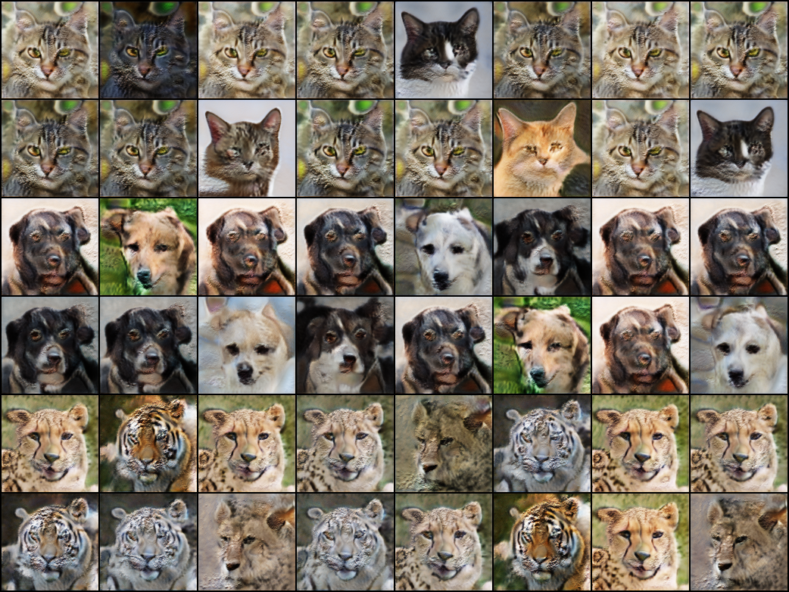

# Animal-Conditioned StyleGAN

A PyTorch implementation of a custom class-conditioned StyleGAN for generating 128x128 colour cat, dog, and wild animal images using the AFHQv2 dataset.

> **Project status:** Active development

## Overview

This project explores conditional image generation with a custom StyleGAN
architecture. The model is conditioned on three AFHQv2 classes:

- Cat
- Dog
- Wild

## Features

- Class-conditioned StyleGAN generator
- StyleGAN discriminator
- Adaptive discriminator augmentation
- Exponential moving average generator weights
- Checkpoint saving and training resumption
- Conditional image generation and class interpolation (incomplete)

## Project Structure

```text
animals-conditioned-stylegan/
├── .gitignore
├── examples/
│   └── epoch_020.png
├── data_loader.py
├── generate.py
├── train.py
├── requirements.txt
└── models/
    ├── ada_augment.py
    ├── discriminator/
    │   ├── blur_pool2d.py
    │   ├── discriminator_block.py
    │   ├── std_batch.py
    │   └── stylegan_discriminator.py
    └── generator/
        ├── adain.py
        ├── blur_upsample2d.py
        ├── conditional_mapping_network.py
        ├── generator_block.py
        ├── noise_injection.py
        ├── pixel_norm.py
        └── stylegan_generator.py
```

## Requirements

- Python 3.10 or newer
- PyTorch and torchvision
- CUDA-compatible GPU recommended

### Setup

Create and activate a virtual environment from the project directory.

On Windows PowerShell:

```powershell
py -3.10 -m venv .venv
.\.venv\Scripts\Activate.ps1
```

On macOS or Linux:

```bash
python3 -m venv .venv
source .venv/bin/activate
```

Install the project dependencies:

```bash
python -m pip install --upgrade pip
python -m pip install -r requirements.txt
```

For NVIDIA GPU training, use the official PyTorch installation instructions to
choose `torch` and `torchvision` builds compatible with your CUDA setup, in place
of the generic versions listed in `requirements.txt`. Training can also run on
CPU, but will be considerably slower.

## Dataset

The training script downloads the AFHQv2 dataset from Kaggle through KaggleHub.
The dataset contains training images organised into `cat`, `dog`, and `wild`
class folders. The first training run downloads the dataset into `data/`.
Ensure the Kaggle account you use has access to the dataset; if KaggleHub
requests authentication, configure your Kaggle credentials before training.

## Training

```bash
python train.py
```

### Training options

| Option | Default | Description |
|---|---:|---|
| `--epochs` | `50` | Number of training epochs |
| `--batch-size` | `32` | Number of images processed per batch |
| `--num-workers` | `0` | Number of data-loading worker processes |
| `--lr-d` | `0.0001` | Discriminator learning rate |
| `--lr-g` | `0.0001` | Generator learning rate |
| `--ema-beta` | `0.995` | Exponential moving average decay for the generator |
| `--mix-prob` | `0.9` | Probability of style mixing during training |
| `--log-interval` | `64` | Log training metrics every this many batches |
| `--r1-gamma` | `0.16` | R1 gradient penalty strength; set to `0` to disable |
| `--r1-interval` | `16` | Apply the R1 penalty every this many batches |
| `--ada` | Disabled | Enable adaptive discriminator augmentation |
| `--ada-target` | `0.6` | Target fraction of positive real discriminator scores for ADA |
| `--ada-kimg` | `250` | ADA adjustment speed in thousands of images |
| `--data-dir` | `data/` | Directory used to download and store the dataset |
| `--output-dir` | `outputs/` | Directory for sample grids and loss plots |
| `--weights-dir` | `weights/` | Directory for checkpoints and model weights |
| `--resume` | None | Resume training from a checkpoint created by this script |

## Generation

After training, the generator's EMA weights are saved to
`weights/generator_ema.pth`. By default, generated images are written to
`outputs/generate/generated_image(s).png`.

Class IDs are `0` for cat, `1` for dog, and `2` for wild. Generate 16 images
with different latent vectors while blending the cat and dog class embeddings:

```bash
python generate.py --base_class 0 --secondary_class 1 --blend 0.5 --total_images 16 --seed 4
```

To generate a 10-image transition grid from cat to dog, use:

```bash
python generate.py --base_class 0 --secondary_class 1 --transition --seed 4
```

## Results

Here is an example grid generated after just 20 epochs. The images look promising, especially given the limited training, but there is a lack of variation. The generator is only capable of producing a handful of distinct animals within each class. This is the current problem I am working to fix.

<p align="center">
    
</p>

## Future Improvements

Using PCA, I have found that the W space is collapsing, with only a handful of dimensions accounting for almost all the variation, despite my hyperparameter tuning. I have altered the mapping network to have only 4 layers and utilise a linear projection of z directly. My intention is to make it harder for the network to collapse W and cause varied latent vectors to map to only a handful of class representations. I have yet to test whether this helps the mapping network.

If this does not seem to help, I will see whether altering the batch standard deviation layer improves image diversity.

Once I am happy with the model's generations, I will look to implement a wide range of generation capabilities. I am looking forward to exploring latent space manipulation to generate custom images of animals and the ability to edit generated images to emphasise a characteristic or morph it into a characteristic of another class.